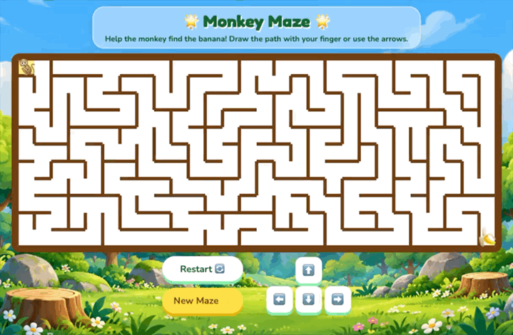

<div align="center">

# 🌟 Monkey Maze Game 🐒

**Help the happy little monkey navigate through procedural mazes to find the banana!**

[](https://developer.mozilla.org/en-US/docs/Web/JavaScript)
[](https://vite.dev/)
[](https://html.spec.whatwg.org/)
[](https://opensource.org/licenses/MIT)

<br/>

<!-- Gameplay GIF Preview -->


</div>

---

## 🎮 How to Play

1. **Objective**: Guide the monkey 🐒 from the top-left corner through the winding maze to reach the banana 🍌 at the bottom-right corner!
2. **Controls**:
   - 👆 **Touch & Mouse Drag**: Click/touch the monkey and drag your finger or cursor along open pathways to carve your trail.
   - 🕹️ **On-Screen D-Pad**: Tap ⬆️, ⬇️, ⬅️, or ➡️ to move one cell at a time.
3. **Smart Path Management**:
   - Moving backward along your existing path automatically erases the previous step.
   - Tapping an earlier cell on your path rolls back to that exact point.
4. **Win Condition**: Reaching the banana launches a celebration confetti shower 🎉 and unlocks the "Play Again" modal!

---

## ✨ Features

- **Procedural Maze Generation**: Every single maze is unique, generated on-the-fly using the **Recursive Backtracker** algorithm.
- **Dual Input Support**: Full touch/swipe gesture support for mobile devices plus click/drag and D-pad controls for desktop.
- **Smooth Backtracking**: Move in reverse or click on an earlier part of your path to easily backtrack without restarting.
- **Instant Controls**:
  - **Restart 🔄**: Clears your drawn path to try the current maze again.
  - **New Maze ✨**: Generates a brand-new maze layout instantly.
- **Victory Confetti**: Celebratory particle effects powered by `canvas-confetti`.

---

## 🧠 Under the Hood

### Recursive Backtracker Algorithm
The maze is dynamically generated as a $28 \times 11$ grid:
1. Start at cell `(0, 0)` and mark it as visited.
2. While there are unvisited cells:
   - If the current cell has unvisited neighbors, pick one randomly, remove the walls between them, and push the current cell to the stack.
   - If no unvisited neighbors exist, backtrack by popping a cell from the stack.
3. This guarantees a **perfect maze** (a maze with no loops and exactly one unique solution path between any two points).

### Touch & Drag Mechanics
Using `document.elementFromPoint(clientX, clientY)`, the game accurately detects which grid cell the user is dragging across in real time on mobile touchscreens without relying on standard mouse enter/leave listeners.

---

## 📂 Project Structure

```text
├── index.html         # Main game layout and markup
├── main.js            # Maze generation algorithm, drawing logic & event handlers
├── style.css          # Game board styles, playful UI & animations
├── image.png          # Forest background artwork
├── demo.gif           # Gameplay animation demo
├── public/            # Static assets (favicons, SVG icons)
├── package.json       # Dependencies and build scripts
└── README.md          # Documentation
```

---

## 🚀 Getting Started

### Prerequisites
- [Node.js](https://nodejs.org/) (version 18+ recommended)

### Run Locally

1. Clone the repository:
   ```bash
   git clone git@github.com:ImaginationStationLafayette/monkey-maze-game.git
   cd monkey-maze-game
   ```

2. Install dependencies:
   ```bash
   npm install
   ```

3. Launch development server:
   ```bash
   npm run dev
   ```

4. Open the local URL provided by Vite (e.g. `http://localhost:5173`) in your browser.

---

## 📄 License

This project is open source and available under the [MIT License](LICENSE).
